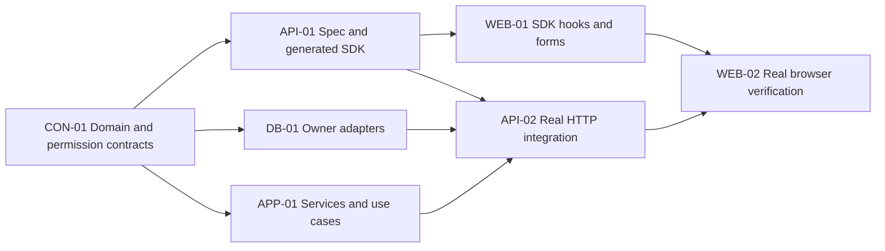

# Delivery modes, readiness and parallel maps

Use for both sequential and parallel plans. Ask once per plan unless its mode is already explicit: “ต้องการทำตามลำดับ (ค่าเริ่มต้น) หรือวางงานแบบขนาน?” Continue independent inspection/design while awaiting an answer. Record `sequential` unless the user chooses parallel; unanswered input is not authorization. Do not ask again after a clear choice.

## Contract and SDK readiness

A usable contract slice has type-checked public entities/schemas, scoped repository/service ports, use-case inputs/results/errors, permission rules, representative accepted/rejected transitions and export paths. Record producer task and artifact revision (commit when available, otherwise an identified workspace artifact). Open decisions block only affected consumers. Contracts do not require repository implementations, rule bodies, HTTP handlers or applied migrations. Never insert placeholder production success to make a milestone appear ready.

| Track             | Start prerequisite                                                   | What remains for real integration                                                       |
| ----------------- | -------------------------------------------------------------------- | --------------------------------------------------------------------------------------- |
| Persistence       | Owned ports and approved storage/permission-catalog design           | Real isolated DB constraints, locks, rollback, migrations and scoped seeds              |
| Application       | Use-case/service ports, authorization and agreed business rules      | Concrete adapters and required collaborators sharing the actual transaction boundary    |
| Pure Domain rules | Agreed inputs/outcomes/errors/examples                               | Application integration; one owner for each rule, no repository I/O                     |
| API spec/client   | Domain + permission + transport contracts                            | Handlers/composition verified against real services; generation itself needs no backend |
| Web               | Generated main-app SDK with frozen request/response/error operations | Successful flows against real authenticated HTTP, then browser verification             |

If an implementation imports an unfinished rule/service, use an existing injection seam with typed test doubles for isolated tests or declare its implementation a prerequisite. Do not claim independent buildability with missing imports. Do not create abstractions merely to draw more lanes.

## Required maps

A main-task map covers its cross-area dependency graph. Every child task includes a small local graph of producer → current task → consumers, with potential independent siblings when relevant. Link the authoritative map instead of duplicating a large graph everywhere. Use Mermaid fenced code and real task codes/links, never labels such as “Backend done” without named artifacts.

Illustrative capability graph (replace codes with actual tasks):



The graph describes dependencies under either mode. In default sequential mode, one valid schedule is `CON-01 → API-01 → WEB-01 → DB-01 → APP-01 → API-02 → WEB-02`. Spec/SDK lets Web work precede backend implementation; Web success still waits for HTTP. Explicit user priorities can change the valid topological order.

In user-selected parallel mode, after `CON-01`, `API-01`, `DB-01` and `APP-01` may run alongside each other if their file sets and imported contracts permit it. `WEB-01` starts only after `API-01`. `API-02` waits for its three real collaborators. Parallel delivery is not authorization for agent spawning, extra chats or background execution.

Each map has a compact scheduling record:

```yaml
execution_mode: sequential
mode_basis: default # or the user's explicit choice
selected_order: [CON-01, API-01, WEB-01, DB-01, APP-01, API-02, WEB-02]
potential_parallel_after_contracts: [API-01, DB-01, APP-01] # not scheduled concurrently
shared_file_owner:
  domain_exports: CON-01
  codegen_registry_and_generated_sdk: API-01
  migration_metadata: DB-01
integration_gate: API-02 # requires real adapters, services and generated contracts
```

For parallel mode, replace selected_order with concrete waves/start gates. For a leaf with no independent work, state `potential parallel: none` and show its producer/current/consumer chain; do not invent peers. Maps must be acyclic, respect every prerequisite and distinguish readiness from completion of whole main tasks. A sibling that edits the same export/codegen/seed/composition file needs a single writer or sequential handoff even in parallel mode.

## Client-first development and evidence

Web production hooks invoke the generated main-application client from the start. No mock fetch, shadow SDK, fake API server or fallback fixture responses merely because handlers are unfinished. Without HTTP, verify imports/types, payload mapping, forms and honest unavailable/error states; do not report successful fetching or persisted writes. A user-requested standalone mockup is a different deliverable with explicit simulated evidence, not the default schedule.

Domain stays independent of HTTP-generated types. DTOs are owned by the main spec and map explicitly between Domain dates/quantities and wire shapes. Do not leak backend composition into browser bundles.

Plan real integration tasks per delivery area: repository/service composition for Application, authenticated handlers with generated contracts for API, Web hooks/forms against real HTTP, then scoped end-to-end checks. Keep database/HTTP/browser evidence separate from type/contract tests. After contract changes, update producer code blocks, affected task links, generation and consumers; block only tasks that consume the changed slice.
